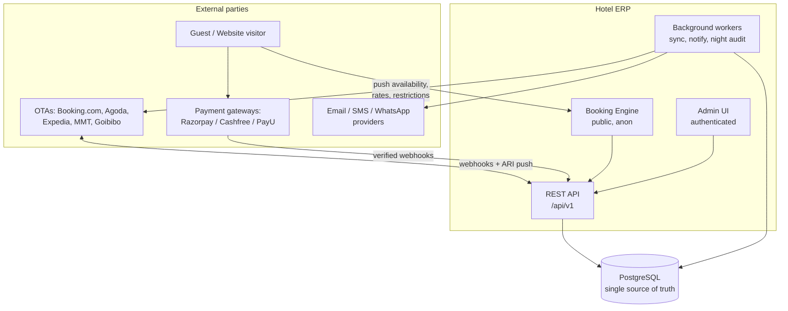
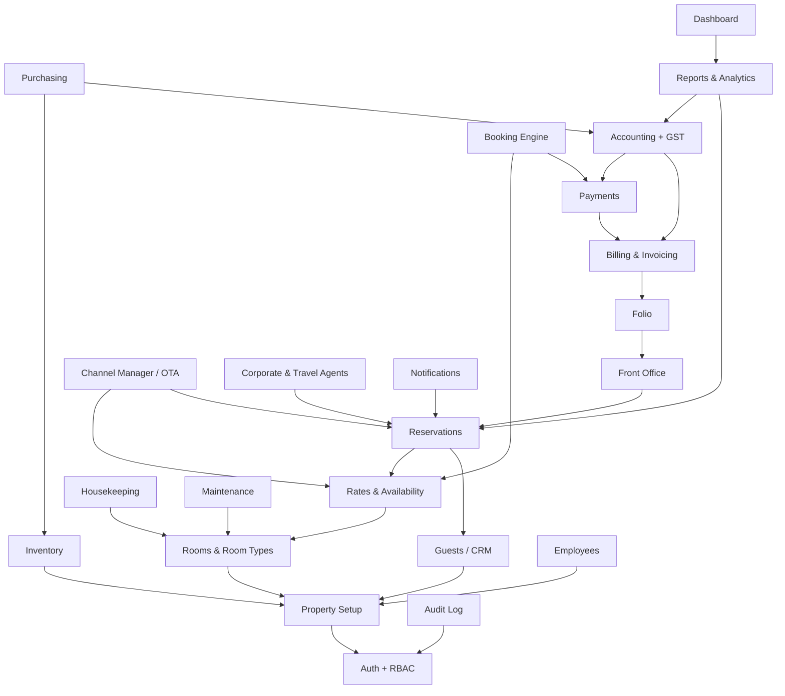

# 01 — System Architecture

Hotel ERP for **Hotel Amoha**, Bengaluru. Single property today, multi-property
and multi-tenant in the schema from day one.

---

## 1. Architectural principles

These are the rules every later phase is held to.

1. **One source of truth per fact.** Room inventory, rates, reservations,
   guests, payments and accounting entries each live in exactly one place. No
   module keeps a private copy or a cached total it maintains by hand.
2. **The database enforces the invariants that matter.** Double booking,
   unbalanced journals, oversold inventory and duplicate OTA bookings are
   prevented by constraints, not by application code a future bug can bypass.
   Application checks give good error messages; the database guarantees
   correctness.
3. **API-first.** Every screen calls the same service layer a partner's API
   call would. There is no UI-only path into the data.
4. **Money is derived, never invented.** Financial reports read the ledger.
   Nothing sums reservation totals to produce a P&L.
5. **Tenancy is structural.** Every business row carries a `property_id`
   reachable to an `organization_id`, and RLS enforces it in the database.
6. **Secrets never reach the database or the browser.** Credentials are
   encrypted application-side; the DB stores ciphertext, the browser gets
   nothing.

---

## 2. Technology stack

| Layer | Choice | Notes |
|---|---|---|
| Frontend | Next.js 16 (App Router), React 19, TypeScript | Desktop-first admin, responsive throughout |
| UI | Tailwind CSS 4 | Token-driven, light and dark |
| API | Next.js Route Handlers (REST) | Versioned under `/api/v1` |
| Validation | Zod | One schema shared by client and server |
| Database | PostgreSQL 16 (Supabase in production) | Constraints, RLS and triggers do the heavy lifting |
| Auth | Supabase Auth, or the local adapter | Selected at runtime by `AUTH_PROVIDER` |
| Background work | Queue tables + worker (`sync_queue`, `notifications`) | Transactional outbox pattern |
| Hosting | Vercel | Preview per PR, production on `main` |

The schema avoids Supabase-only features in its core, so it runs on any managed
PostgreSQL. The `auth.users` foreign key is added conditionally (see
`0001_foundation.sql`), which is what lets the whole test suite run on a plain
local cluster in CI.

---

## 3. System context



Everything converges on one database. The two headline flows are the same
pipeline after the first hop:

```
OTA booking  → Channel adapter → webhook_events → ota_reservations
                                → Reservation → PMS → Folio → Invoice
                                → Payment → Journal → Reports → Dashboard

Web booking  → Booking Engine → Payment gateway (verified server-side)
                              → Reservation → PMS → Folio → Invoice
                              → Payment → Journal → Reports → Dashboard
```

---

## 4. Module dependency map

Arrows point from a module to what it depends on. Nothing depends on a module
above it, which is what makes the phase order in the roadmap buildable.



**Critical path:** Auth → Property → Rooms → Rates → Reservations → Front
Office → Folio → Billing → Payments → Accounting. Everything else hangs off
that spine.

---

## 5. Application structure

```
hotel-erp/
├── db/
│   ├── migrations/         12 numbered, forward-only SQL migrations
│   ├── seed/               demo data (clearly marked, guarded, never auto-run)
│   └── tests/              fixtures + the SQL integrity suite
├── scripts/                migrate / test / local-database helpers
├── docs/                   this documentation set
└── src/
    ├── app/
    │   ├── (auth)/login/         login
    │   ├── (admin)/              the ERP itself, one folder per module
    │   └── api/v1/               REST handlers, one folder per resource
    ├── modules/<module>/service.ts   business logic + data access
    ├── lib/                      db, auth, api, errors, format
    └── components/               shared UI
```

**Layering rule:** `app/` (HTTP and rendering) → `modules/` (business rules) →
SQL. A page and an API handler call the same service, so there is one code path
and one set of rules.

---

## 6. Transaction boundaries

One business action is one database transaction. The important ones:

| Action | Inside the transaction |
|---|---|
| Create reservation | reserve inventory (locked) → reservation → stay lines → nightly rates → allocate rooms → open folio → enqueue channel sync |
| Check in | validate status → assign room → set room occupied → post first night → status → history |
| Post payment | payment row → journal entry + lines → folio/reservation totals via triggers |
| Issue invoice | allocate number → invoice + items → journal entry → mark folio items invoiced |
| Ingest OTA booking | webhook_events (dedupe) → ota_reservations → reservation → allocations → inventory |

The channel push is enqueued in the *same* transaction that changed
availability (transactional outbox). A crash therefore cannot leave the OTA
believing rooms are for sale that the PMS has already sold.

---

## 7. Error handling

Every API response uses one envelope:

```jsonc
{ "data": { }, "meta": { "page": 1, "pageSize": 50, "total": 214 } }

{ "error": { "code": "NO_AVAILABILITY",
             "message": "Deluxe Room is sold out for 12–14 Sep.",
             "details": [ { "field": "arrivalDate", "issue": "..." } ],
             "requestId": "..." } }
```

Database error codes are translated into application codes at the repository
boundary (`src/lib/errors.ts`) — `exclusion_violation` on `room_allocations`
becomes `ROOM_ALREADY_ALLOCATED`, the capacity check on `inventory_daily`
becomes `NO_AVAILABILITY`. The user sees "that room was just taken", not a
constraint name.

---

## 8. What is deliberately NOT built yet

- **No OTA is connected.** Adapters are an interface with a mock
  implementation. Real adapters are written only when the hotel holds approved
  API credentials. Mock channels are constrained at the database level so they
  can never be displayed as a live connection (`channels_mock_chk`).
- **No payment gateway is connected.** Same approach: an interface plus a mock.
- **Modules beyond Phase 1 have no screens.** Their routes exist and say so
  rather than presenting a mockup.
