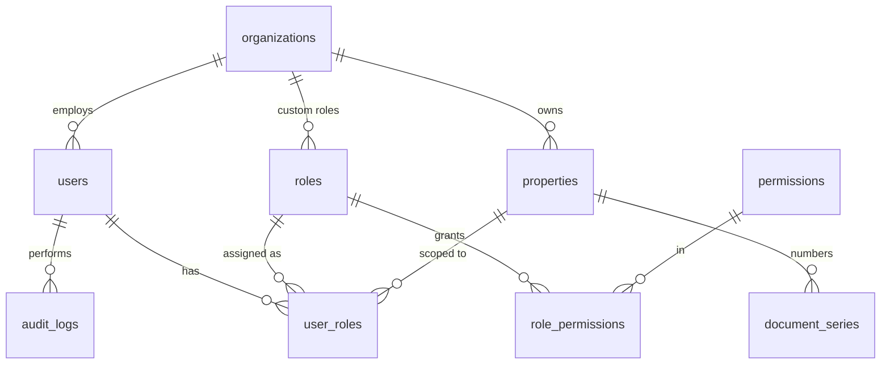
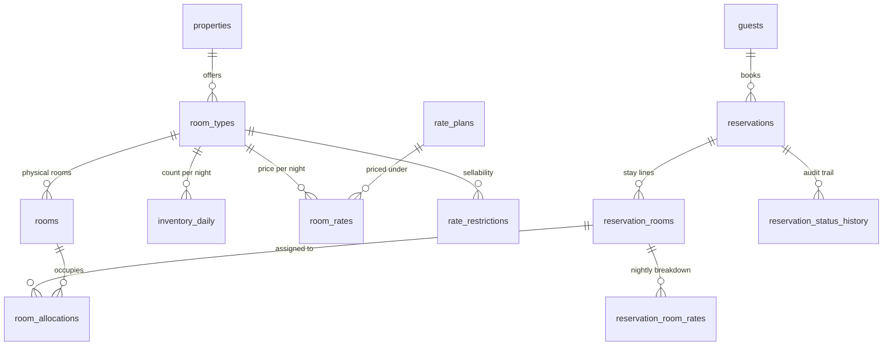
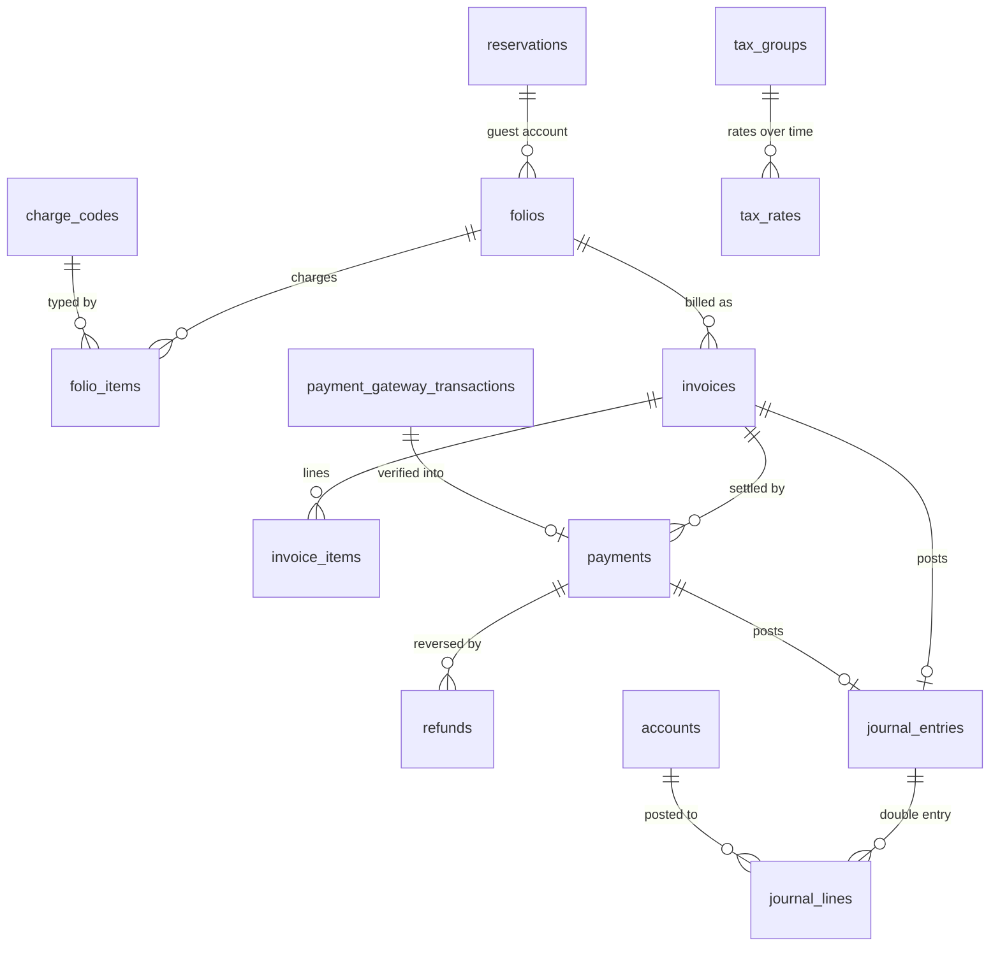
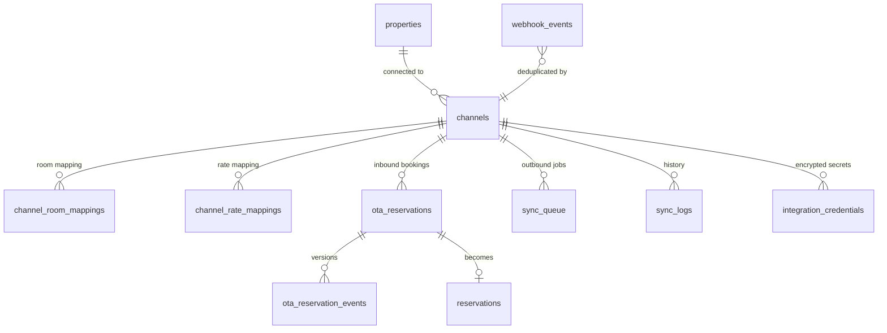

# 02 — Database Design

PostgreSQL 16. **94 tables, 3 views, 34 enums, 291 foreign keys, 173 check
constraints, 120 unique constraints, 4 exclusion constraints, 276 indexes,
101 RLS policies, 78 triggers.**

Every migration in `db/migrations/` has been applied to a real PostgreSQL 16
instance and the invariants below are covered by the suite in `db/tests/`.

---

## 1. The three design decisions that matter most

### 1.1 Commercial line vs physical line

Most PMS bugs come from storing "which room" on the booking row. This schema
splits them:

| | `reservation_rooms` | `room_allocations` |
|---|---|---|
| Answers | *What was sold?* | *Which room is occupied, when?* |
| Holds | room type, rate plan, dates, occupancy, money | room id, date range, active flag |
| Cardinality | one per room sold | **one or more** per stay line |

A mid-stay room move is two allocations against one stay line — full history,
no lost revenue attribution. An unassigned booking simply has no allocation
yet, which is normal for an OTA booking two months out.

Crucially, **out-of-order blocks and house use are rows in the same table**.
That is what lets a single constraint cover every reason a room is
unavailable:

```sql
CONSTRAINT room_allocations_no_overlap
  EXCLUDE USING gist (room_id WITH =, stay_range WITH &&) WHERE (is_active)
```

`stay_range` is a generated `daterange` with `'[)'` bounds, so **checkout day
is free for the next arrival**: a stay 10→14 and a stay 14→16 in the same room
do not conflict, while 12→16 does. Both behaviours are asserted by tests.

### 1.2 Two independent layers of availability control

| Layer | Guards | Mechanism |
|---|---|---|
| Room type | Selling more Deluxe rooms than exist | `inventory_daily` capacity CHECK + `SELECT … FOR UPDATE` |
| Physical room | Putting two guests in room 101 | `room_allocations` exclusion constraint |

They are independent on purpose. The first stops overselling before rooms are
assigned (the normal OTA case); the second stops a bad assignment at the front
desk. Either alone would leave a real gap.

`app.reserve_inventory()` locks the affected nights **in date order** so
concurrent bookings serialise deterministically and cannot deadlock.

### 1.3 Ledger-derived financials

`journal_entries` + `journal_lines` are the only source for financial
reporting. Four rules are enforced by the database:

1. A line is a debit **or** a credit, never both, never zero (CHECK).
2. A posted entry balances — deferred constraint trigger, so a header and its
   lines can be written as separate statements in one transaction and the
   check fires at COMMIT.
3. A posted entry is immutable; corrections are reversals (BEFORE trigger).
4. Nothing posts into a `CLOSED` or `LOCKED` period (BEFORE trigger, which
   also resolves `period_id` from the entry date).

`journal_entries_source_uq` additionally allows only one non-reversed entry
per source document, so re-running a posting job cannot double-count revenue.

---

## 2. Entity relationship overview

### Tenancy and access



`user_roles.property_id IS NULL` means the grant covers **every** property in
the organization. That single nullable column is the whole answer to "a user
may have access to one property, several, or all".

### Inventory, pricing and the room-night ledger



### Money



### Channels



---

## 3. Table catalogue

| Domain | Tables |
|---|---|
| Tenancy & access | `organizations`, `properties`, `users`, `roles`, `permissions`, `role_permissions`, `user_roles`, `settings`, `document_series`, `audit_logs`, `idempotency_keys`, `user_credentials`, `user_sessions` |
| Rooms & rates | `room_types`, `rooms`, `amenities`, `room_type_amenities`, `room_type_images`, `rate_plans`, `rate_plan_room_types`, `rate_seasons`, `room_rates`, `rate_restrictions`, `inventory_daily`, `cancellation_policies` |
| Guests | `guests`, `guest_documents`, `booking_sources` |
| Reservations | `reservations`, `reservation_rooms`, `reservation_room_rates`, `reservation_guests`, `reservation_status_history`, `room_allocations` |
| Billing | `tax_groups`, `tax_rates`, `charge_codes`, `folios`, `folio_items`, `folio_item_taxes`, `invoices`, `invoice_items` |
| Payments | `payment_methods`, `payments`, `refunds`, `payment_gateway_transactions` |
| Accounting | `accounts`, `fiscal_years`, `accounting_periods`, `journal_entries`, `journal_lines` |
| Inventory | `uoms`, `item_categories`, `inventory_items`, `stores`, `stock_balances`, `stock_movements`, `stock_counts`, `stock_count_items` |
| Purchasing | `suppliers`, `purchase_requests(+items)`, `purchase_orders(+items)`, `goods_receipts(+items)`, `purchase_invoices(+items)` |
| Operations | `housekeeping_tasks`, `assets`, `maintenance_tickets`, `maintenance_attachments` |
| HR | `departments`, `employees`, `attendance`, `leave_requests`, `employee_advances` |
| B2B & CRM | `corporate_accounts`, `corporate_rate_contracts`, `travel_agents`, `crm_leads`, `crm_activities` |
| Channels | `channels`, `channel_room_mappings`, `channel_rate_mappings`, `ota_reservations`, `ota_reservation_events`, `webhook_events`, `sync_queue`, `sync_logs`, `integration_credentials` |
| Messaging | `notification_templates`, `notifications`, `api_keys` |

Views: `v_availability`, `v_general_ledger`, `v_trial_balance`.

---

## 4. Constraints that encode business rules

| Constraint | Prevents |
|---|---|
| `room_allocations_no_overlap` (EXCLUDE) | Double booking a physical room |
| `inventory_daily_capacity_chk` | Overselling a room type |
| `fiscal_years_no_overlap` (EXCLUDE) | Overlapping financial years |
| `corporate_rate_contracts_no_overlap` (EXCLUDE) | Two active contract rates for the same company/room type/date |
| `invoices_cgst_sgst_chk` | CGST ≠ SGST on an intra-state invoice |
| `invoices_gst_mode_chk` | CGST/SGST and IGST on the same invoice |
| `invoices_total_chk` | An invoice whose total does not equal its parts |
| `invoices_b2b_gstin_chk` | A B2B invoice with no buyer GSTIN |
| `invoices_credit_note_chk` | A credit note not linked to an invoice |
| `folio_items_math_chk` | A folio line whose arithmetic does not close |
| `journal_lines_one_side_chk` | A line that is both debit and credit |
| `webhook_events_uq` | Processing the same webhook delivery twice |
| `webhook_events_verified_chk` | Marking an unverified webhook successful |
| `ota_reservations_uq` | Two staging rows for one OTA booking |
| `reservations_external_ref_uq` | Two reservations from one OTA booking |
| `pg_txn_payment_uq` | Banking one gateway payment twice |
| `pg_txn_captured_chk` | Capturing without server-side verification |
| `channels_mock_chk` | A mock adapter presented as a live channel |
| `channels_enabled_chk` | Enabling an unconfigured channel |
| `purchase_invoices_supplier_uq` | Entering the same supplier bill twice |
| `purchase_order_items_received_chk` | Receiving more than was ordered |
| `stock_movements_direction_chk` | A consumption that increases stock |

Append-only tables (UPDATE/DELETE blocked by trigger): `audit_logs`,
`reservation_status_history`, `stock_movements`, and posted `journal_entries`
/ `journal_lines`.

---

## 5. Money, dates and identifiers

- **Money:** `numeric(14,2)` for amounts, `numeric(16,2)` for ledger totals,
  `numeric(14,4)` for unit costs. Never floating point.
- **Dates:** stay dates are `date`, not timestamps — a hotel night is a
  calendar date in the property's timezone, and storing it as a timestamp
  causes off-by-one bugs across the night-audit boundary. Event times are
  `timestamptz`.
- **Ranges:** `daterange` with `'[)'` bounds everywhere a stay is expressed.
- **Keys:** UUID v4 primary keys throughout, so records can be created
  client-side and merged from channels without collisions. Human-facing
  numbers come from `document_series`: sequential per property, per document
  type, per financial year (`INV-2026-27/00001`), allocated under a row lock.

---

## 6. Running it

```bash
./scripts/dev-db.sh start     # local PostgreSQL 16 for development/CI
./scripts/dev-db.sh reset     # drop and recreate the erp database
./scripts/db-migrate.sh       # apply every migration in order
./scripts/db-test.sh          # migrate + fixtures + all three suites
```

Against a remote database, set `DATABASE_URL` and run the same scripts.

Migrations are **forward-only and additive**. No migration drops or rewrites a
column holding production data; a replacement column is added, backfilled, and
the old one retired in a later release once nothing reads it.
