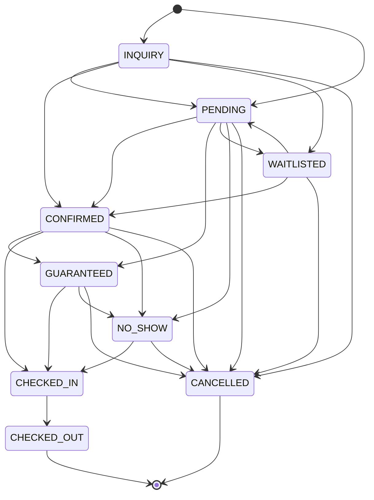
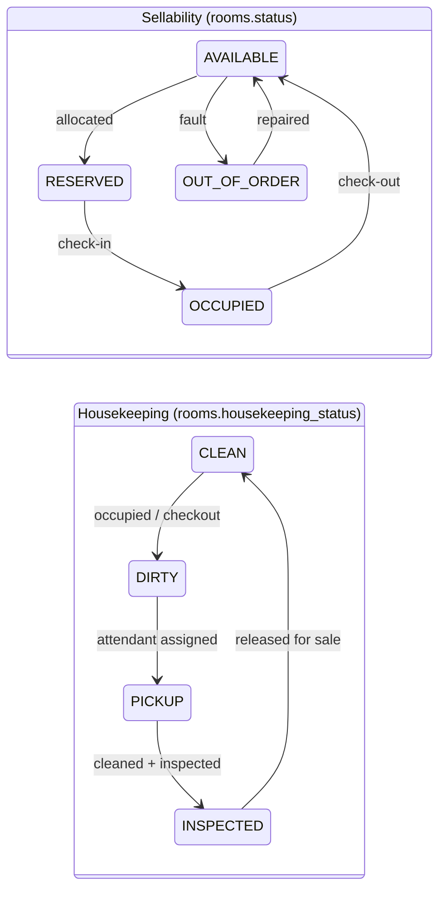
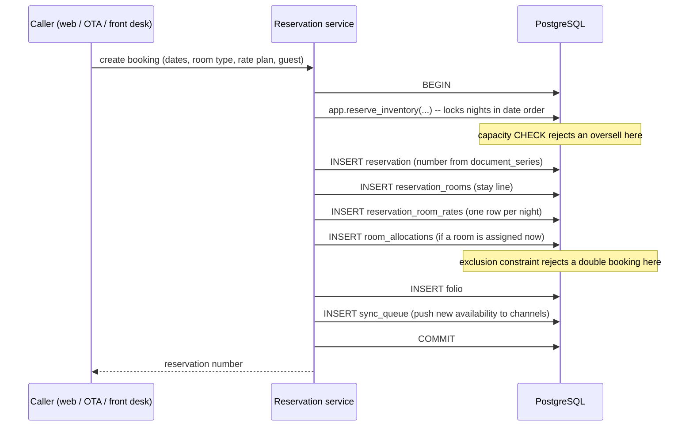

# 04 — Reservation & Room Inventory Lifecycle

---

## 1. Reservation states



The transition table is enforced by `app.track_reservation_status()`. An
illegal jump — `CHECKED_OUT → CONFIRMED`, for instance — raises rather than
silently corrupting the night audit, and every accepted transition writes a
row to `reservation_status_history` with the actor. Both are covered by tests.

Which states hold inventory:

| State | Holds a room? |
|---|---|
| `INQUIRY`, `WAITLISTED` | No |
| `PENDING` | Yes, until the hold expires |
| `CONFIRMED`, `GUARANTEED`, `CHECKED_IN` | Yes |
| `CHECKED_OUT`, `CANCELLED`, `NO_SHOW` | No — allocation released |

---

## 2. Room state

Two orthogonal dimensions, kept in separate columns. A room can be
`OCCUPIED` + `DIRTY`, or `AVAILABLE` + `DIRTY`; collapsing them into one field
is the classic PMS bug where housekeeping overwrites front office.



A room is sellable only when it is `AVAILABLE`, active, and has no active
`room_allocations` row overlapping the requested dates.

---

## 3. Booking a room, step by step



Everything is one transaction. A failure at any point leaves no partial
booking, no leaked inventory, and no queued channel push for a booking that
does not exist.

---

## 4. Why double booking cannot happen

Four defences, each independent, all in the database.

**1. Room-type oversell.** `inventory_daily` carries

```sql
CHECK (sold_rooms + blocked_rooms + ooo_rooms <= total_rooms + overbooking_limit)
```

`app.reserve_inventory()` locks the affected nights with `SELECT … FOR UPDATE`
**ordered by date** — deterministic lock ordering, so simultaneous bookings
serialise instead of deadlocking — then increments `sold_rooms`. The loser
hits the CHECK and is rejected with `NO_AVAILABILITY`.

**2. Physical room collision.** The exclusion constraint on
`room_allocations`.

**3. Duplicate OTA delivery.** Unique keys on `webhook_events(provider,
event_id)`, `ota_reservations(channel_id, external_reservation_id)` and
`reservations(property_id, channel_id, external_reference)`.

**4. Duplicate API call.** `idempotency_keys` — a repeated request with the
same key returns the stored response instead of booking twice.

### The race the brief asks about

*An OTA booking and a direct website booking arrive at nearly the same moment
for the last room.* Run by `scripts/db-test-concurrency.sh` with two genuinely
concurrent sessions:

```
PASS  website booking blocks while the OTA booking holds the inventory lock
PASS  OTA booking succeeded
PASS  website booking was rejected instead of overselling
PASS  final sold count is 2 of 2 rooms (no oversell)
PASS  second assignment waits on the exclusion constraint
PASS  first room assignment succeeded
PASS  second room assignment rejected by the database
PASS  exactly one active allocation survives for that room and window
```

One booking wins, the other receives a clean error. The hotel is never
oversold, regardless of how the transactions interleave.

---

## 5. Modifications

| Operation | How it is represented |
|---|---|
| **Room change** (mid-stay) | Deactivate the current allocation from the move date; insert a new one for the remaining nights. Both remain as history. |
| **Room upgrade** | Update the stay line's `room_type_id`, re-price the affected nights, move inventory between types, re-allocate. |
| **Extend stay** | Reserve inventory for the extra nights *first*; extend the stay line and allocation; add `reservation_room_rates` rows. Fails cleanly if sold out. |
| **Shorten stay** | Shorten allocation and stay line, release inventory, remove unposted nights. Already-posted nights stay on the folio. |
| **Split booking** | Multiple `reservation_rooms` under one reservation, each independently allocated. |
| **Group booking** | A master reservation with `is_group_master`; members reference it via `group_reservation_id`. |
| **Early check-in / late check-out** | A folio charge using the `EARLYCI` / `LATECO` charge code; if it consumes an extra night, inventory is reserved for it. |
| **Cancellation** | Status → `CANCELLED`, allocations deactivated, inventory released, cancellation fee posted per policy, channels notified. |
| **No-show** | Status → `NO_SHOW` at night audit, no-show fee posted, room released. |

Every one is a single transaction, and every one enqueues a channel sync so
the OTAs see the freed or consumed inventory.

---

## 6. Nightly rate breakdown

`reservation_room_rates` holds one row per night per stay line. This exists so
that:

- Room revenue is posted per night by the night audit, matching how a hotel
  actually earns it.
- A partial stay bills correctly without dividing a total by nights.
- A rate change mid-stay is represented exactly rather than averaged.
- Occupancy, ADR and RevPAR are computed from real per-night data.

`is_posted` marks nights the night audit has already pushed to the folio, so a
re-run cannot double-post.

---

## 7. Night audit

The scheduled job that closes a business day, per property, at
`night_audit_time`:

1. Post room charges and taxes for every in-house stay for the night.
2. Flag expected arrivals that never checked in as `NO_SHOW` and apply the
   policy fee.
3. Set departed rooms to `DIRTY` and raise checkout-clean housekeeping tasks.
4. Roll `inventory_daily` forward and recompute occupancy.
5. Post the day's summary journals.
6. Snapshot the day's KPIs for the dashboard.
7. Push refreshed availability to every enabled channel.

It is idempotent: each step keys off `is_posted` / `source_id` uniqueness, so
running it twice for the same date changes nothing.

---

## 8. Reservation calendar

Rows are rooms (grouped by type), columns are dates, blocks are allocations.
It reads from `room_allocations` joined to `reservation_rooms` — the
`room_allocations_property_idx` and the GiST index on `stay_range` keep the
window query fast.

Drag to move a booking to another room, or to extend it, and the client issues
the corresponding API call. If the target is taken, the exclusion constraint
rejects it and the UI restores the block and shows "room 102 is already
occupied for those dates" — the calendar cannot create a conflict even if two
staff drag at the same moment.
