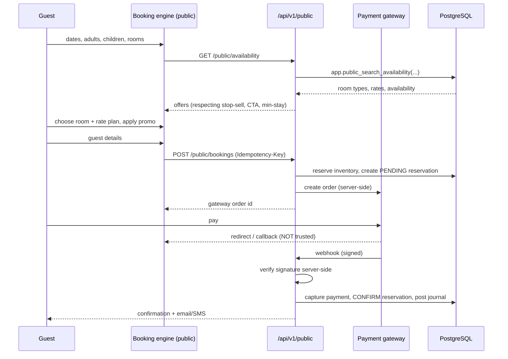

# 05 — Direct Booking Engine

The hotel's own channel. Zero commission, so every booking moved here from an
OTA is worth ~15–18% more.

---

## 1. Flow

The browser's "payment succeeded" callback is never trusted. A reservation
becomes `CONFIRMED` only after the server verifies the gateway signature or a
signed webhook. Until then it is `PENDING` with a hold that expires.

---

## 2. Holds and expiry

A `PENDING` reservation holds inventory for 15 minutes (configurable). A
scheduled sweeper cancels expired holds, releases inventory, and pushes the
freed availability to the channels. Without this, abandoned checkouts would
slowly strangle availability.

---

## 3. Public API surface

Only these five endpoints are reachable without a session, all rate-limited
per IP and per API key, and CORS-restricted to `api_keys.allowed_origins`:

| Endpoint | Purpose |
|---|---|
| `GET /api/v1/public/property` | Name, address, photos, policies, amenities |
| `GET /api/v1/public/availability` | Search results with prices |
| `POST /api/v1/public/bookings` | Create a pending booking (idempotent) |
| `POST /api/v1/public/payments/initiate` | Create a gateway order server-side |
| `GET /api/v1/public/bookings/:ref` | Retrieve a booking (reference + email/phone) |

Behind them, the database exposes exactly one function to `anon` and no tables
at all.

---

## 4. Conversion design

- **Mobile-first.** Most Indian direct bookings are on a phone.
- **Three steps:** search → select → pay. No account required.
- **Minimal fields:** name, mobile, email. Address and ID are collected at
  check-in, where they are legally needed, not in the funnel.
- **Price transparency:** taxes shown before the payment step.
- **Trust markers:** branding, room photos, amenities, an explicit
  cancellation policy, a secure-payment indicator, reviews placeholder.
- **Promo codes** validated server-side against the rate plan and dates.
- **Offers** surfaced from active `rate_seasons` of type `PROMOTION`.

---

## 5. Website integration

| Method | Use |
|---|---|
| **Direct URL** | `book.hotelamoha.com?checkin=…&checkout=…&adults=2` |
| **JS widget** | One `<script>` tag renders a search box that deep-links in |
| **iframe** | For sites that cannot add scripts |
| **REST API** | Partners build their own front end with an API key |

The widget carries the property id and a scoped API key; the key is
origin-restricted, rate-limited and revocable from Settings, so a leaked
public key cannot be abused from another domain.

---

## 6. Rate parity

The engine reads the same `room_rates` and `rate_restrictions` as the channel
push. There is no separate "website price" table to drift out of sync —
parity is structural. Where the hotel *chooses* to undercut the OTAs, that is
an explicit direct-only rate plan (`is_public = true`,
`is_channel_enabled = false`), a deliberate decision rather than an accident.
