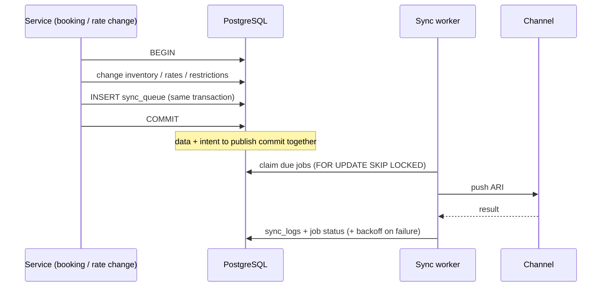
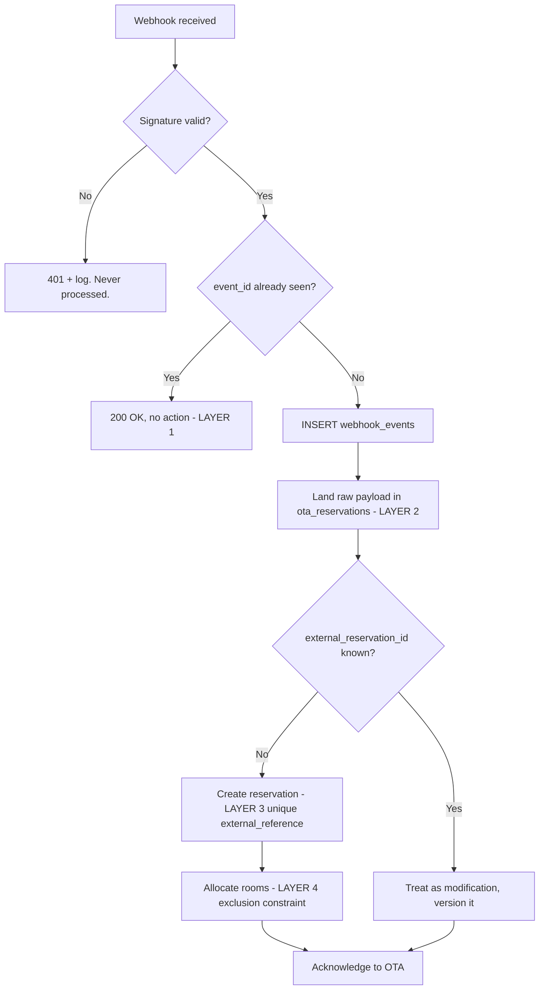

# 06 — Channel Manager & OTA Integration

**No OTA is connected. No OTA API is faked.** This phase defines the
architecture and the safety mechanisms; real adapters are written only when
Hotel Amoha holds approved API credentials for a given OTA.

---

## 1. Adapter abstraction

The ERP is not built around any one OTA. Every channel implements one
interface, and the rest of the system talks only to that interface.

```ts
export interface ChannelAdapter {
  readonly code: string;
  readonly mode: 'MOCK' | 'SANDBOX' | 'PRODUCTION';

  testConnection(): Promise<ConnectionResult>;

  // Outbound: ARI (availability, rates, inventory restrictions)
  pushAvailability(dates: DateRange, items: AvailabilityItem[]): Promise<SyncResult>;
  pushRates(dates: DateRange, items: RateItem[]): Promise<SyncResult>;
  pushRestrictions(dates: DateRange, items: RestrictionItem[]): Promise<SyncResult>;

  // Inbound: reservations
  fetchReservations(since: Date): Promise<ExternalReservation[]>;
  acknowledgeReservation(externalId: string): Promise<void>;

  // Inbound: push
  verifyWebhook(raw: string, headers: Headers): Promise<boolean>;
  parseWebhook(raw: string): Promise<ChannelEvent>;

  // Reservation write-back where the channel supports it
  createReservation(r: Reservation): Promise<ExternalReservation>;
  modifyReservation(r: Reservation): Promise<ExternalReservation>;
  cancelReservation(externalId: string, reason: string): Promise<void>;
}
```

Adding Booking.com later means writing one file in
`src/integrations/channels/booking-com/`. No table changes, no changes to the
reservation service.

Architecturally supported: Booking.com, Agoda, Expedia, MakeMyTrip, Goibibo,
Airbnb, and channel-manager aggregators.

### Mock vs real — enforced, not documented

```sql
CONSTRAINT channels_mock_chk CHECK ((mode = 'MOCK') = (adapter LIKE 'MOCK_%'))
CONSTRAINT channels_enabled_chk CHECK (
  NOT is_enabled OR connection_status IN ('CONNECTED','ERROR'))
```

A mock adapter cannot be labelled as a production channel, a real adapter
cannot silently run in mock mode, and a channel cannot be switched on until it
is genuinely configured. The database refuses all three. The UI labels mock
channels as **SANDBOX — not connected to a live OTA** everywhere they appear.

---

## 2. Outbound sync — the transactional outbox



Because the job is written in the *same transaction* as the data change, a
crash can never leave the OTA advertising rooms the PMS has already sold.

`sync_queue_dedupe_uq` allows only one **pending** job per
`(channel, dedupe_key)`, so a burst of twenty rate edits for September
collapses into one push. Failed jobs retry with exponential backoff up to
`max_attempts`, then land in `DEAD` for manual retry.

---

## 3. Inbound reservations — four layers of idempotency



| Layer | Constraint | Stops |
|---|---|---|
| 1 | `webhook_events(provider, event_id)` UNIQUE | The same delivery processed twice |
| 2 | `ota_reservations(channel_id, external_reservation_id)` UNIQUE | Two staging rows for one booking |
| 3 | `reservations(property_id, channel_id, external_reference)` UNIQUE | Two reservations from one booking |
| 4 | `room_allocations` EXCLUDE | The room committed twice |

**If an OTA sends the same webhook twice, no second reservation is created.**
Asserted directly by the test suite, along with the rule that an unverified
webhook can never be marked `SUCCESS` (`webhook_events_verified_chk`).

The raw payload is landed *before* it is parsed, so a parsing bug never loses
a booking — it can be replayed from `raw_payload`. Every version of a booking
is kept in `ota_reservation_events`, which is what makes an OTA dispute
resolvable months later.

---

## 4. Mapping

`channel_room_mappings` and `channel_rate_mappings` translate between the
OTA's identifiers and ours. Both carry uniqueness in **both** directions, so
an inbound booking always resolves to exactly one room type — an ambiguous
mapping is rejected at configuration time rather than producing a
mis-allocated booking at 2am. An unmapped inbound booking is parked as
`MANUAL_REVIEW` rather than guessed.

---

## 5. Commission and net revenue

`channels.commission_percent` and `channels.payment_model` drive it:

- **Hotel collect** — the hotel takes the money; commission is a payable.
  Debit `5300 OTA Commission`, credit `2160 Other Payables`.
- **OTA collect** — the OTA takes the money and remits net. Debit
  `1150 Accounts Receivable – OTA` for the net, debit `5300 OTA Commission`
  for the commission, credit room revenue and output GST for the gross.

Because commission is its own expense account and every reservation carries
its `booking_source_id`, the owner dashboard shows gross revenue, commission
and **net revenue per channel** from the ledger rather than an estimate.

---

## 6. Health and observability

Per channel: connection status, last sync time, last successful sync,
consecutive failure count, last error. Sync failures raise a notification
rather than failing quietly. `sync_logs` keeps the full request/response of
every attempt with credentials redacted, which is what makes an OTA support
ticket answerable.
