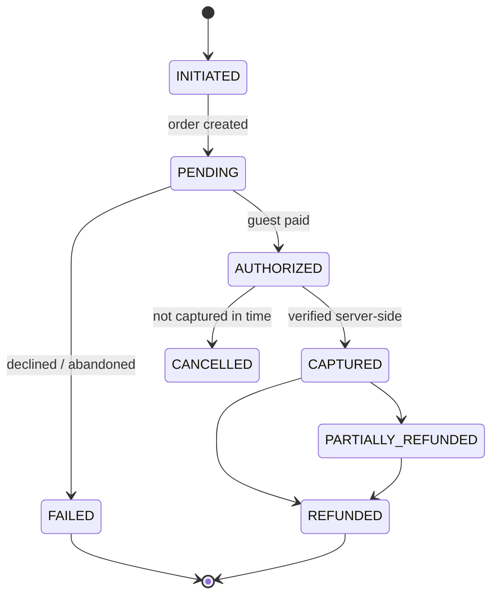

# 07 — Payment Architecture

**No gateway is connected.** An interface plus a mock adapter; real adapters
are added when credentials exist.

---

## 1. Abstraction

```ts
export interface PaymentGatewayAdapter {
  readonly code: string;                       // RAZORPAY | CASHFREE | PAYU | MOCK
  readonly mode: 'MOCK' | 'SANDBOX' | 'PRODUCTION';

  createOrder(o: OrderRequest): Promise<GatewayOrder>;
  verifyPaymentSignature(p: SignaturePayload): Promise<boolean>;
  fetchPayment(gatewayPaymentId: string): Promise<GatewayPayment>;
  capturePayment(gatewayPaymentId: string, amount: Money): Promise<GatewayPayment>;
  refund(gatewayPaymentId: string, amount: Money, reason: string): Promise<GatewayRefund>;
  verifyWebhook(raw: string, headers: Headers): Promise<boolean>;
  parseWebhook(raw: string): Promise<GatewayEvent>;
}
```

---

## 2. States



---

## 3. The rule that matters

**The frontend is never trusted.** A gateway transaction reaches `CAPTURED`
only through server-side verification, and the database enforces it:

```sql
CONSTRAINT pg_txn_captured_chk CHECK (
  status <> 'CAPTURED' OR signature_verified_at IS NOT NULL
                       OR webhook_received_at IS NOT NULL)
```

A forged browser callback claiming success cannot produce a captured payment,
because no code path can write that row without one of those timestamps.

Two independent confirmation paths, both verified, both idempotent:

1. **Redirect** — the browser returns with a signature; the server verifies it
   using the secret (HMAC), then captures.
2. **Webhook** — the gateway posts a signed event; the server verifies the
   signature, deduplicates on `webhook_events(provider, event_id)`, then
   captures.

Whichever arrives first wins; the second is a no-op. This is what makes a
dropped redirect (a guest closing the tab after paying) still result in a
confirmed booking.

---

## 4. No double payments

```sql
CONSTRAINT pg_txn_payment_uq UNIQUE NULLS NOT DISTINCT (gateway, gateway_payment_id)
```

A gateway payment id can be banked exactly once. Combined with
`idempotency_keys` on the initiate endpoint and webhook deduplication, a
double-clicked checkout, a retried request and a replayed webhook all converge
on one payment row. Asserted by tests.

---

## 5. Payment to ledger

Every payment posts a balanced journal entry in the same transaction.
Advance received at booking (₹5,600 including 12% GST):

| Account | Debit | Credit |
|---|---:|---:|
| 1120 Bank Account | 5,600.00 | |
| 2130 Advance from Guests | | 5,600.00 |

On check-out the advance is applied against the invoice, moving it from a
liability to settled revenue. Gateway fees post to `5320 Payment Gateway
Charges` on settlement, so net realisation per channel is visible.

Triggers keep `folios.total_payments`, `folios.balance`,
`reservations.paid_amount` and `reservations.payment_status` in step
automatically — no service can forget to update them, and they cannot drift.
Verified by tests.

---

## 6. Refunds

Refunds require `payments.refund`, which front desk does **not** hold. The
flow is: request → approve → gateway call → `refunds` row → reversing journal
entry → guest notified. The original payment is never edited; the refund is a
separate, linked record, so the audit trail shows what happened rather than a
mutated history.

---

## 7. Other payment methods

Cash, card, UPI, bank transfer, cheque, wallet, city ledger (credit to a
corporate account), OTA-collect and complimentary are all `payment_methods`
rows, each mapped to the cash/bank/receivable account it settles into. Adding
a method is configuration, not code.
